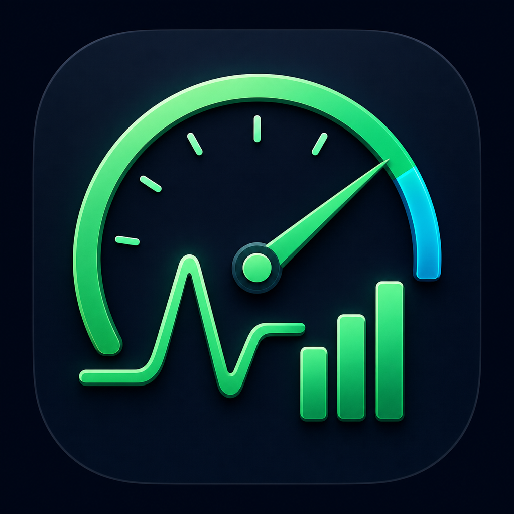

<h1 align="center">FastBar</h1>

<p align="center">
  
</p>

<p align="center">
  Your current Fast.com download speed, always visible in the macOS menu bar.
</p>

<p align="center">
  <a href="https://github.com/f/fastbar/releases/latest"></a>
  <a href="https://github.com/f/fastbar/actions/workflows/build.yml"></a>
  <a href="https://github.com/f/fastbar/blob/main/LICENSE"></a>
  
</p>

FastBar is a small native SwiftUI menu-bar app. It runs a Fast.com download test every 10 minutes by default, displays the latest result directly in the menu bar, and keeps a local seven-day timeline with a rolling three-hour average.

## Install

### Homebrew

```bash
brew install f/tap/fastbar
```

### Manual

Download **FastBar.dmg** from the [latest release](https://github.com/f/fastbar/releases/latest), open it, and drag FastBar into Applications.

The release is ad-hoc signed but not notarized. If macOS blocks the first launch, run:

```bash
xattr -cr /Applications/FastBar.app
```

## Features

- Current download speed in the menu bar
- Fast.com’s own adaptive measurement logic
- Configurable 1, 5, 10, 15, 30, or 60 minute checks
- 10-minute default interval
- Rolling three-hour average
- 24-hour chart and seven-day local history
- Manual refresh
- No Dock icon and no account required

## How measurement works

Like [fast-cli](https://github.com/sindresorhus/fast-cli), FastBar loads Fast.com and reads the completed result from the page instead of estimating bandwidth from a tiny fixed download. FastBar uses a private, invisible WebKit view, normalizes the reported unit to Mbps, and saves the result locally.

If the page cannot finish within 60 seconds, FastBar tries a direct Netflix Open Connect probe and then a Cloudflare probe. Fallback results are labeled in the history.

Fast.com chooses the amount of data and duration dynamically. Short check intervals can use significant bandwidth.

## Privacy

FastBar does not operate a server and does not collect analytics. Measurements stay in the app’s sandboxed Application Support directory. Running a test connects to Fast.com/Netflix infrastructure; the final fallback connects to Cloudflare.

## Build from source

Requirements:

- macOS 14 or later
- Xcode 26 or later

```bash
git clone https://github.com/f/fastbar.git
cd fastbar
open FastBar/FastBar.xcodeproj
```

Choose the **FastBar** scheme and **My Mac**, then press Run.

To produce the universal release DMG:

```bash
./build.sh
```

The artifact is written to `build/release/FastBar.dmg`.

## Contributing

Contributions are welcome. See [CONTRIBUTING.md](CONTRIBUTING.md) and [CODE_OF_CONDUCT.md](CODE_OF_CONDUCT.md).

## License

MIT © Fatih Kadir Akın. See [LICENSE](LICENSE).
